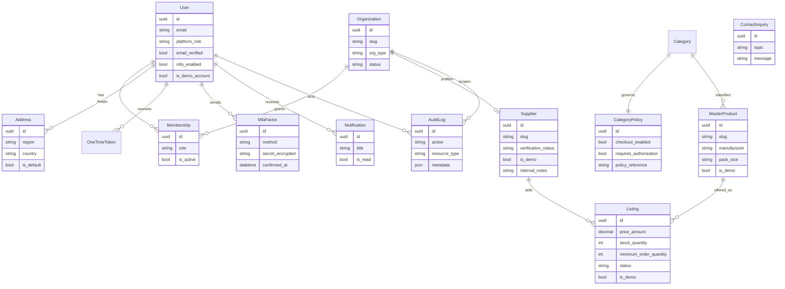

# Database model

PostgreSQL is the system of record. The diagram below is the schema created by the current migrations. Later domains are listed after the diagram and do not have tables yet.

## Constraints that protect invariants

- One membership row per user and organization.
- One default address per user.
- One active TOTP factor per user.
- Listing price and stock cannot be negative.
- Minimum order quantity is at least 1.
- Supplier SKU is unique per supplier.
- Email is stored lowercase and is unique.

## Planned tables (not migrated)

These names describe the next slices. Columns will be designed in the migration that introduces them.

- Credential document, review decision, and expiry for professionals and suppliers.
- Cart, customer order, merchant order, and order event.
- Payment intent, ledger entry, webhook receipt, and settlement.
- Warehouse, stock lot, reservation, shipment, and proof of delivery.
- Professional service, availability rule, slot hold, and appointment.
- Requisition, approval step, RFQ, quotation, purchase order, and goods receipt.

Appointment overlap will use a PostgreSQL exclusion constraint on the resource and the active time range. Payment webhook receipts will be unique on provider plus event id.
