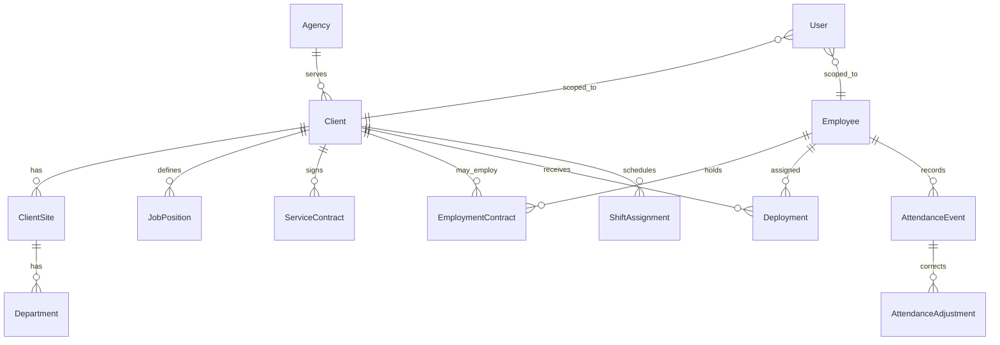

# Entity relationships

A user is an agency role, a single client user, or a single employee. The legal employer on the employment contract is independent of which organization currently hosts the deployment.
